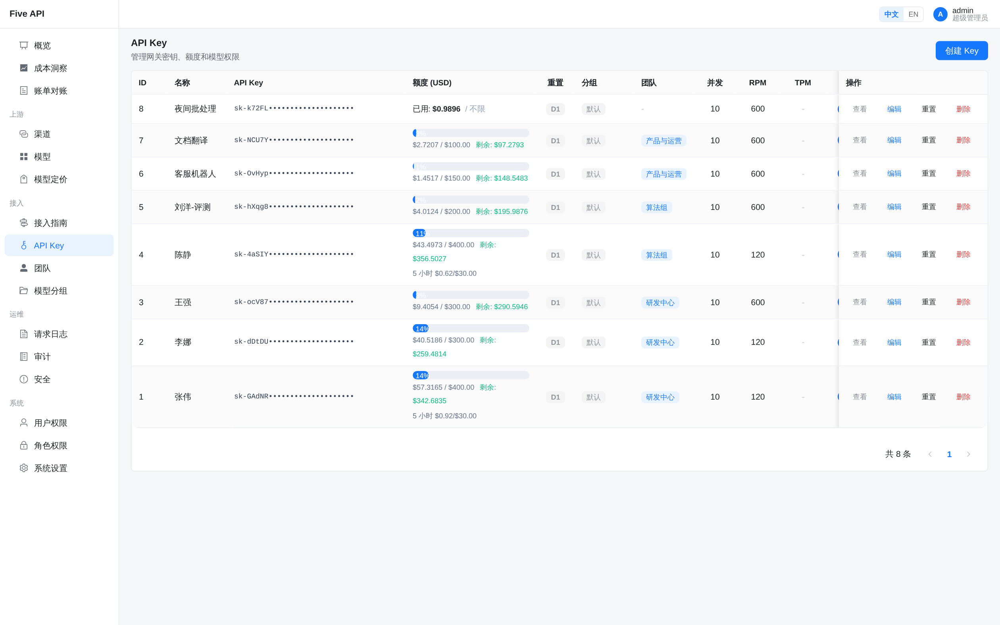
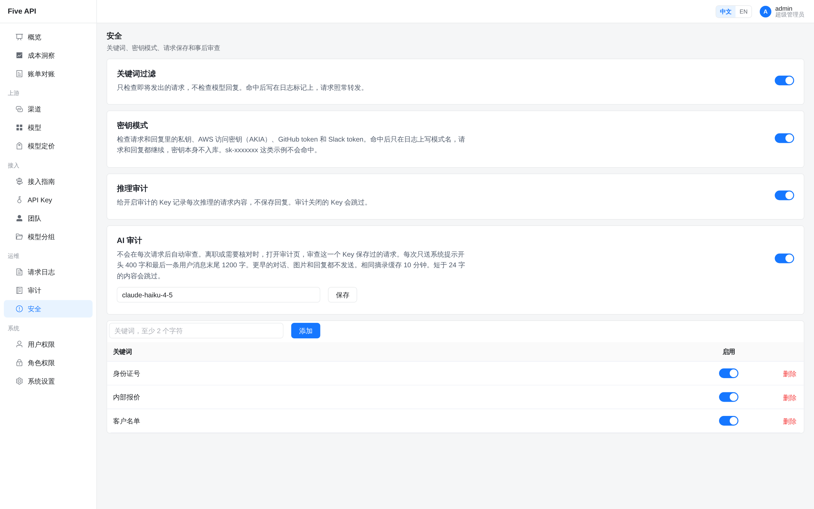
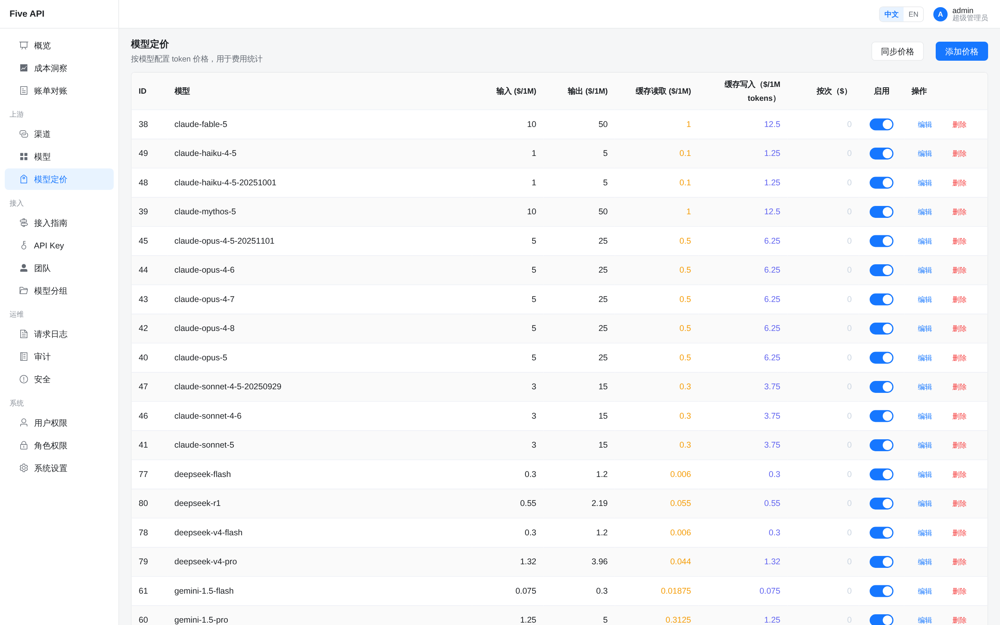

# Five API

[中文](README.md) · [Changelog](CHANGELOG.md)

[](https://github.com/timmy1688/five-api/actions/workflows/ci.yml)

A self-hosted AI gateway for teams. Claude Code, Codex, Cursor, and the SDKs all point at one address. Upstream keys stay in the gateway, every person is billed in USD, failing channels are swapped out automatically, and spend reconciles with the vendor bill line by line.

Deploy with one `docker compose up -d`. The admin UI and the API run in the same process.

## Why Five API

### Native protocols. Clients only change the base URL

- Claude Code and the Anthropic SDK use `/v1/messages`, forwarded as-is to an Anthropic channel. `tool_use`, `thinking`, streaming, and vendor beta fields arrive intact.
- The OpenAI SDK, Codex, and Cursor use `/v1/*`: chat, responses, embeddings, images, audio, and rerank are all passed through.
- Upstream rate-limit headers come back unchanged, so SDK backoff keeps working. One model can have a channel for each protocol.
- Claude Code and the Codex CLI have both run multi-turn tool-calling tasks through the gateway in testing.

```bash
export ANTHROPIC_BASE_URL=http://your-server
export ANTHROPIC_API_KEY=sk-your-gateway-key
```

### High availability. Upstream failures are routed around

- Same-protocol channels are tiered by priority and picked by weight, fewest in-flight requests, or lowest latency.
- A channel can hold a pool of upstream keys. A 429 cools a key down for `retry-after`, a 401 or 403 for 10 minutes, and the next key takes over.
- 5xx, timeouts, and network errors fail over to the next channel, and streams fail over before the first byte. Repeated failures open a circuit breaker, and a background probe closes it.
- When every channel for a model fails, a fallback chain moves to the next model, for example `claude-opus-4-7 → claude-sonnet-4-6`.
- Sticky sessions keep a conversation on one channel and one key, so the upstream cache keeps hitting.
- When a client disconnects or an upstream stream breaks, the request is still billed, logged, and its concurrency slot released.

### Exact billing. Every cent is accounted for

- Quota is USD on the key. One request has four prices: input, cache read, cache write, and output. Images, audio, and rerank add a per-request price.
- OpenAI and Anthropic usage are normalized to one scheme, with Anthropic cache tokens added back before billing.
- An estimate is reserved when the request starts and settled from real usage when it ends. Parallel calls hold their share, so a quota is exceeded by one request at most.
- Teams share one budget. Keys and teams can cap USD spend over the last 5 hours, 24 hours, and 7 days.
- Time-of-day pricing multiplies cost inside chosen hours, matching off-peak discounts or peak surcharges.
- Every log row carries a cost breakdown: usage per bucket, unit price, price source, and cache savings.

### Cost control. Spend less and see where it goes

- Cost insights charts the daily cache hit rate and money saved, split by model, key, and channel, and lists the most expensive sessions.
- Auto cache marks tools, the system prompt, and the last message on Anthropic requests that carry no `cache_control`.
- Budget downgrade swaps an expensive model for a cheaper one near the cap, and the `x-five-downgraded-to` header names it.
- Reconciliation takes the vendor's CSV export, detects the date, cost, and model columns, compares each day and model with gateway billing, and flags rows over or under.

### Security and compliance without getting in the way

- Upstream keys are stored encrypted, and members only hold gateway keys. Each key can limit models, IPs, requests per minute, tokens per minute, concurrency, and expiry.
- Keyword and secret scanning (private keys, AWS access keys, GitHub tokens, Slack tokens) only marks the log, and the call goes on. The log stores the pattern name, never the secret.
- Inference audit is per key and stores requests only. AI review runs on demand from the Audit page, one request at a time, sending the first 400 characters of the system prompt and the last 1,200 characters of the latest user message, and ends with a report.
- 21 fine-grained permissions with custom roles. Failed logins are rate limited, and a password change signs out every earlier session.

### Easy to operate

- No `.env` file, migrations run on start, and all data lives in `./data`.
- `/healthz` reports MySQL and Redis, and `/metrics` serves Prometheus.
- Budget thresholds, circuit open and recovery, and a high 5xx share go to Feishu, DingTalk, WeCom, or any JSON webhook.
- The Get started page turns a key into ready-to-copy configs for Claude Code, Codex, Cursor, and the SDKs.
- Smoke, regression, and load test suites cover passthrough, failover, billing, and rate limits.

| | Five API | A typical gateway |
|---|---|---|
| Protocol | Passed through as-is, Claude Code tools and thinking reach the upstream intact | Converted into another format, then forwarded |
| Billing | Per person in USD, four price buckets, reserved before the call | Totals only |
| Availability | Key pool cooldowns, failover, circuit breaker, model fallback, sticky sessions | One failing channel fails the request |
| Cost | Cache insights, auto cache, budget downgrade, bill reconciliation | Totals only |
| Security | A hit is only marked, and requests are reviewed per key as excerpts | A hit stops the request |

## Screenshots









## Production

Install Docker, then from the project directory:

```bash
docker compose up -d
```

No `.env` file is required. Compose pulls `ghcr.io/timmy1688/five-api` when a release exists and builds from source otherwise. The admin UI and the API share one port, host port 80 by default. Open `http://your-server`. The first login is `admin` / `admin123`, and the UI asks for a new password before anything else. The database, Redis, and the signing key live in `./data`. `docker compose down` leaves that directory in place.

MySQL and Redis publish their ports on `127.0.0.1` only, so other machines cannot reach them. The gateway talks to them over the container network. The gateway trusts `X-Forwarded-For` only from the local machine.

The gateway waits for MySQL and Redis before it runs migrations. `/healthz` reports both, and the Docker health check uses it. `/metrics` answers only inside the container by default. To scrape it from Prometheus, set `METRICS_TOKEN` in `docker-compose.yml` and send `Authorization: Bearer <token>`.

To change the published port or a password, edit the values in `docker-compose.yml`, then run `docker compose up -d` again. `INIT_ADMIN_PASSWORD` applies only when the admin account is created. Changing a password signs out every earlier session. Ten failed logins from one IP or for one username within 15 minutes pause logins for 15 minutes.

```bash
docker compose up -d --build   # rebuild after changing the source; pip and npm use mirrors in China
docker compose logs -f gateway
docker compose down
```

After an upgrade, click Sync latest prices on Model Pricing once. Changes per version are in [CHANGELOG.md](CHANGELOG.md).

## Development

You need Python 3.11+, Node.js 20+, and Docker. Compose still starts MySQL and Redis with the defaults above. No `.env` file is required.

```bash
./service.sh install
./service.sh start
```

The frontend is at `http://localhost:5001` and the backend at `http://localhost:5002`. The dev server forwards `/api` and `/v1` to the backend.

```bash
./service.sh stop
./service.sh logs
```

The database account matches the values in `docker-compose.yml`. To change a password, change it in that file and put the same values in a `.env` file for the local backend.

## Connect

`provider` is the wire protocol. `openai` covers OpenAI, Gemini, Qwen, vLLM, and compatible relays. `anthropic` covers Claude, or DeepSeek’s Anthropic endpoint (`https://api.deepseek.com/anthropic`).

Copy `sk-xxx` when the key is created; it is shown once. Sync the built-in prices on Model Pricing. A channel price of 0 makes that tier free.

Fields the client left out stay out, so the upstream applies its own defaults. Upstream rate-limit headers (`x-ratelimit-*`, `anthropic-ratelimit-*`, `retry-after`, `request-id`) come back unchanged, so SDK backoff keeps working. The upstream `x-request-id` is renamed `x-upstream-request-id`; the gateway's own `X-Request-ID` is for log lookup. `/v1/messages/count_tokens`, which Claude Code calls, goes to an Anthropic channel and is not billed. When the upstream lacks it, the gateway returns a local estimate.

| Endpoint | Channel | Billing |
|---|---|---|
| `/v1/chat/completions` `/v1/completions` `/v1/embeddings` | openai | tokens |
| `/v1/responses` (streaming too) | openai | tokens, from `response.completed` when streaming |
| `/v1/messages` | anthropic | tokens |
| `/v1/images/generations` `/v1/images/edits` `/v1/images/variations` | openai | per-request price for each image, plus tokens when the upstream reports them |
| `/v1/audio/speech` | openai | input characters at the input price (enter the per-million-character price), plus the per-request price |
| `/v1/audio/transcriptions` `/v1/audio/translations` | openai | per-request price, plus tokens when the upstream reports them |
| `/v1/rerank` | openai | tokens the upstream reports, plus the per-request price |
| `/v1/videos` with `/{id}`, `/{id}/content`, `/{id}/remix` | openai | seconds × per-request price (enter the per-second price) on submit; polling and download are free |

Enter per-request prices on Model Pricing, or in column Q of a channel's pricing.

```python
from openai import OpenAI
client = OpenAI(api_key="sk-your-gateway-key", base_url="http://your-server/v1")
client.chat.completions.create(model="gpt-4o", messages=[{"role": "user", "content": "Hello"}])
```

```
fresh = prompt - cache_read - cache_write
cost  = (fresh × input + cache_read × cache_read_price + cache_write × cache_write_price + completion × output) / 1_000_000
```

Channel price wins, then the global price. A channel row without a write price uses that channel's input price. An explicit 0 makes writes free. Quota is reserved up front and settled from the real usage. Sync default prices once so Claude write prices become 1.25× input.

## Rest

```bash
cd backend && ../.venv/bin/pytest -m smoke && ../.venv/bin/pytest -m regression
```

Optional environment variables are in [.env.example](.env.example). Architecture is in [CLAUDE.md](CLAUDE.md). [MIT License](LICENSE). Cost is an estimate and can differ from the upstream invoice. The full statement is in [DISCLAIMER.md](DISCLAIMER.md) (Chinese).
