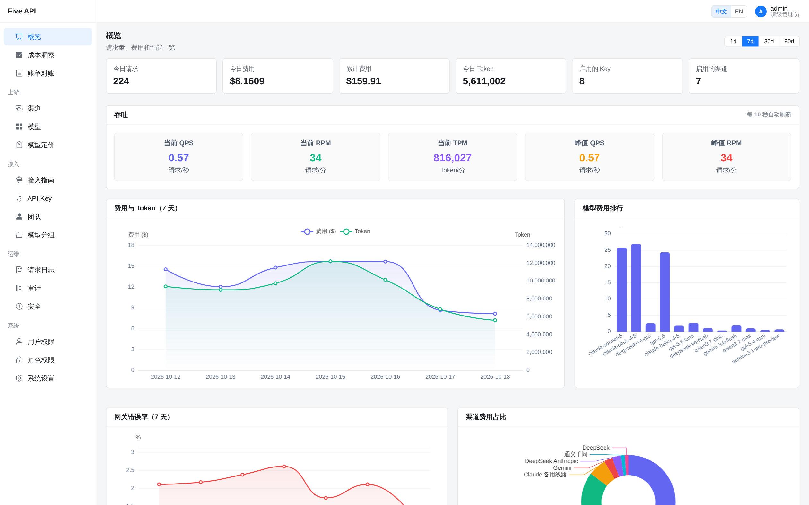
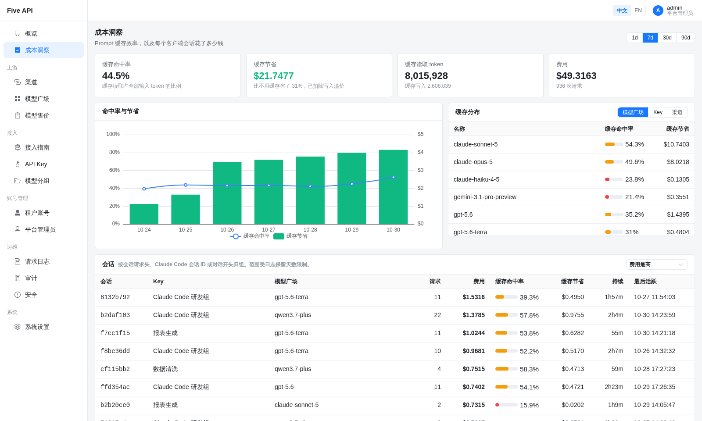
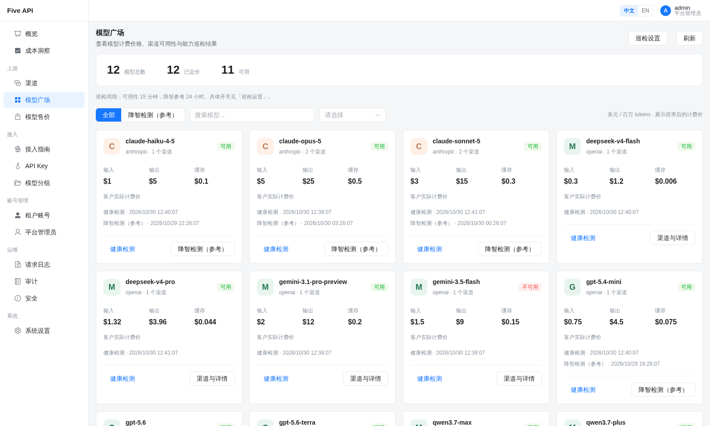
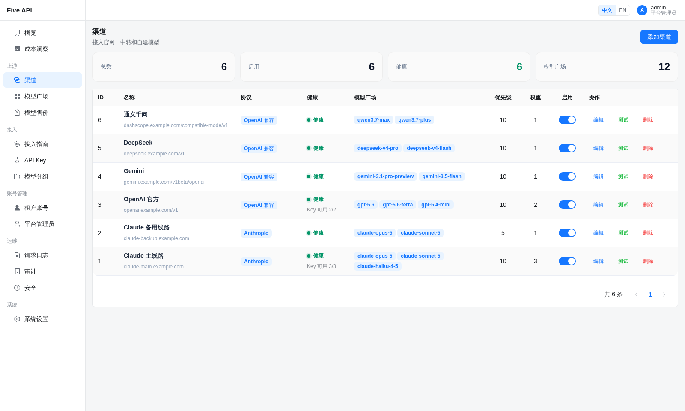
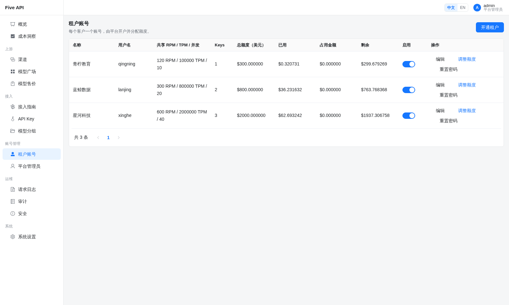
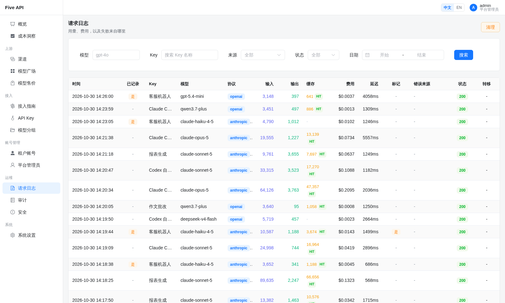
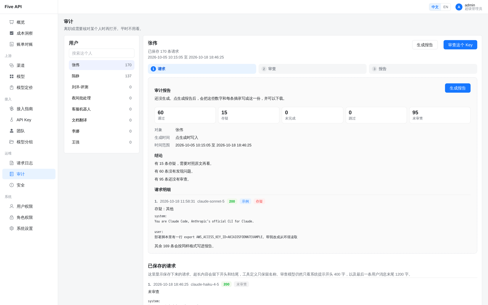
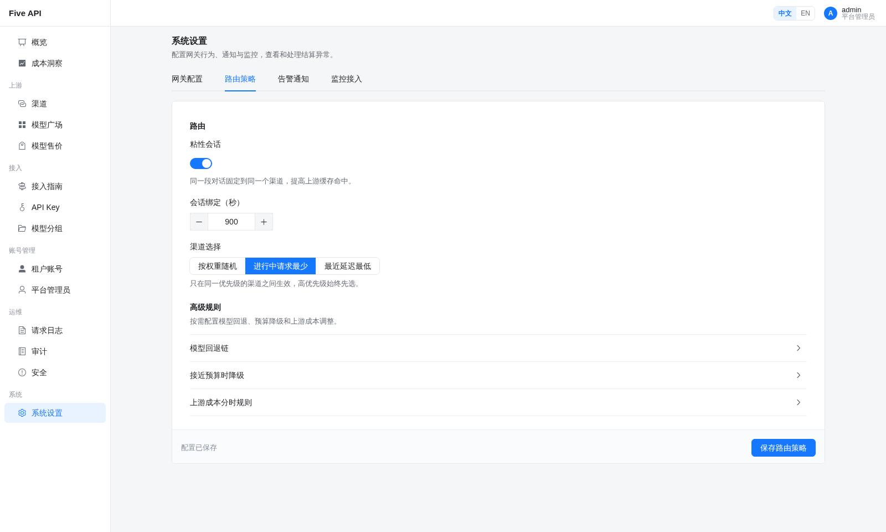
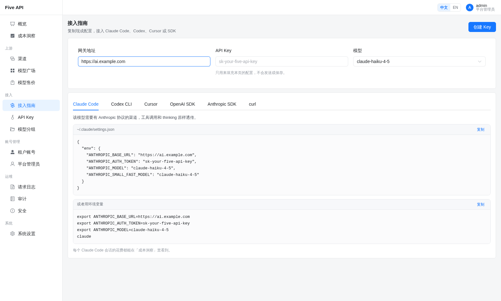

# Five API

[English](docs/README.en.md) · [运维与升级](docs/OPERATIONS.md) · [兼容矩阵](docs/COMPATIBILITY.md) · [更新记录](CHANGELOG.md)

[](https://github.com/timmy1688/five-api/actions/workflows/ci.yml)

自托管的多租户 AI 网关。接入 OpenAI、Claude、Gemini、DeepSeek、通义千问等上游，给客户或部门开户、分配美元额度，账算得准、钱不漏、调用可审计。MIT 许可，可商用，`./service.sh deploy` 一条命令部署。



## 为什么选 Five API

- **余额打不穿**：每个请求按输入加输出上限足额预占，在 MySQL 行锁事务里连同在途请求一起核对租户和 Key 余额。记账不可用直接拒绝，绝不先放行后补账。
- **同一模型，渠道不同价**：每个渠道按模型售价乘以价格倍率，也可以给单个模型设固定价；客户在 Key 上选择渠道，只在所选渠道间切换，按实际服务的渠道计费。
- **漏配价格不会白用**：模型没配售价就拒绝请求，只有显式填 0 才免费。
- **调用可审计，泄密可追查**：按 Key 保存请求内容，自动扫描私钥、AWS、GitHub、Slack 等密钥；员工离职或怀疑泄密时，一键让便宜模型逐条审查这个 Key 最近的请求，生成可下载的审计报告；审过的不重复送审，日志再多也不浪费 token。
- **上游掉线、Key 失效自动绕开**：5xx、超时、429、上游 Key 失效都会切换渠道，流式请求在首包前切换；连续失败自动熔断。图片、视频等不幂等请求不会被重复提交。
- **能发现模型被降智**：定时健康检测，另外每天用合成题检查 GPT/Claude 渠道的指令遵循、推理和工具调用，留存历史作为退化信号。
- **企业功能全部开源**：租户自管 Key、IP 白名单、内容审计、AI 审查都在 MIT 版本里，没有企业版。

## 和 new-api、LiteLLM 对比

| | Five API | [new-api](https://github.com/QuantumNous/new-api) | [LiteLLM](https://github.com/BerriAI/litellm) |
|---|---|---|---|
| 定位 | 平台开户、按客户分账 | 公开中转站，自助注册、在线充值 | 企业内部出口，100+ 供应商 |
| 预扣费 | 输入加输出上限足额预占，MySQL 事务核对 | 只预扣估算输入；余额超 10 美元跳过预扣 | 依赖 Redis，硬上限需另开 fail-closed |
| 未配置价格 | 拒绝请求 | 返回价格错误 | 放行，按 0 记账 |
| 请求内容审计 | 按 Key 保存，密钥扫描，AI 审查出报告 | 日志不保存请求内容，管理员查看提问的需求标为[无计划](https://github.com/QuantumNous/new-api/issues/7609) | 可开启保存 prompt；密钥检测属[企业版](https://docs.litellm.ai/docs/enterprise) |
| 租户自管 Key、IP 白名单 | MIT 版本包含 | 支持 | 团队管理员、IP 白名单属企业版 |
| 模型质量检测 | 健康检测 + 降智参考检测 | 连通性和响应时间 | 连通性 |

对比依据 2026 年 10 月的公开文档和 Issue。new-api 的预扣行为见 `trust_quota_usd`，成本核算见 [#4933](https://github.com/QuantumNous/new-api/issues/4933)；LiteLLM 预算见[文档](https://docs.litellm.ai/docs/proxy/users)，缺价按 0 记账见[文档](https://docs.litellm.ai/docs/proxy/cost_tracking)。

**适合选别的情况**：需要自助注册、在线支付、兑换码，选 new-api；需要 Bedrock、Vertex 等大量供应商或协议互转，选 LiteLLM；需要多副本高可用或 SSO，Five API 目前不支持。

## 功能一览

- **协议**：Anthropic SDK、Claude Code 走 `/v1/messages`，OpenAI SDK、Codex、Cursor 走 `/v1/*`，原生透传不互转。支持 chat、responses、embeddings、图片、语音、rerank、视频。
- **计费**：输入、缓存读、缓存写、输出四档分别计价，图片、语音、视频可按次计价；Key 扣费、租户扣费、请求日志在同一事务提交。
- **租户**：平台管理员和租户两种角色；租户只能管理自己的 Key，所有查询在服务端校验归属。
- **路由**：优先级分层，同层按权重、最少在途或最低延迟选路；多 Key 号池、粘性会话、模型回退链。
- **省钱**：成本洞察按天看缓存命中和节省金额；Anthropic 请求可自动加缓存标记；额度接近上限时自动降级到便宜模型。
- **安全**：上游 Key 加密存储，主密钥与 JWT 密钥分离且不入库；API Key 明文只显示一次。

## 界面

| 成本洞察 | 模型广场 |
|---|---|
|  |  |
| **渠道** | **租户账号** |
|  |  |
| **请求日志** | **审计报告** |
|  |  |
| **路由策略** | **接入指南** |
|  |  |

## 快速部署

```bash
./service.sh deploy   # 首次自动在 .env 生成网关密钥，再构建并启动全部容器
```

打开 `http://127.0.0.1:8080`，用 `admin` / `admin123` 登录，首次登录会强制改密码。上线前改掉 `docker-compose.yml` 里的数据库密码，并把 `.env` 和数据库分开备份：丢了密钥，已保存的上游 Key 无法解密。**从旧版本升级先看 [运维文档](docs/OPERATIONS.md)**，不能直接替换镜像。

## 接入

平台添加渠道、配置售价、开通租户；租户创建 Key 后，客户端只改地址：

```python
from openai import OpenAI

client = OpenAI(api_key="sk-your-gateway-key", base_url="https://ai.example.com/v1")
print(client.chat.completions.create(
    model="gpt-5.6", messages=[{"role": "user", "content": "Hello"}],
).choices[0].message.content)
```

Anthropic SDK 和 Claude Code 的 `base_url` 填网关根地址。端点和已验证的 SDK 版本见 [兼容矩阵](docs/COMPATIBILITY.md)。

## 使用边界

- 只支持单进程部署；没有在线支付、SSO、组织层级和自定义角色。
- Claude Code、Codex、Cursor 提供配置示例，未做逐版本端到端认证。
- 降智检测只是回归信号，不能证明上游真实型号；定时检测的上游费用由平台承担。
- 计费以上游返回的用量为准，可能与厂商账单口径不同；请同时在上游账户设置预算告警。

本地开发和测试见 [贡献指南](CONTRIBUTING.md)。安全问题请勿公开提交 Issue，也不要附带密钥、提示词或数据库内容。
