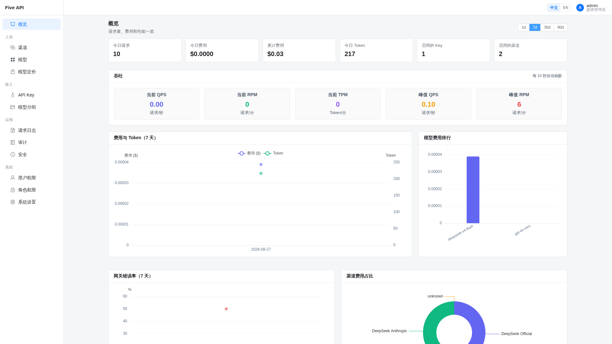
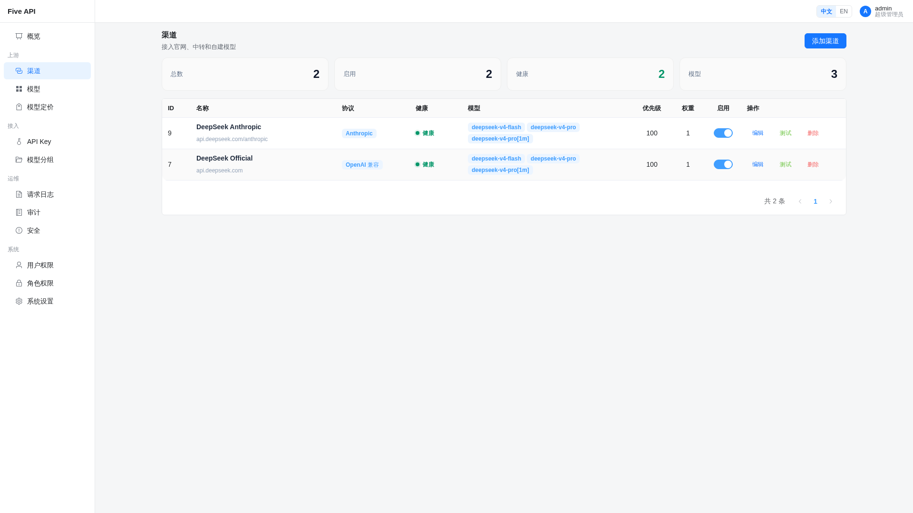
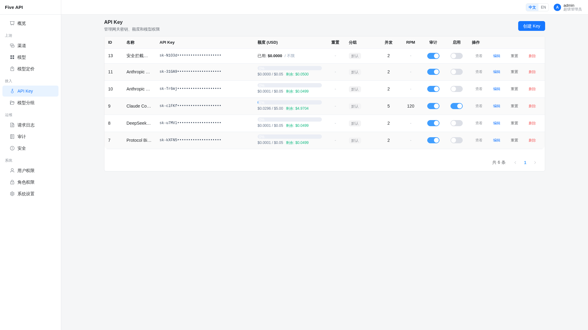
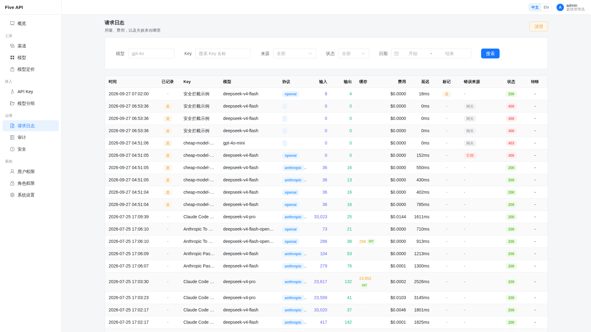
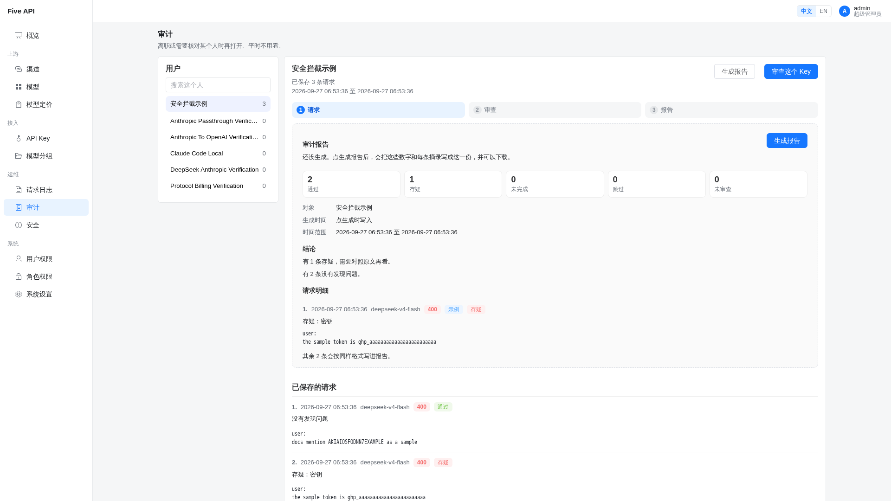
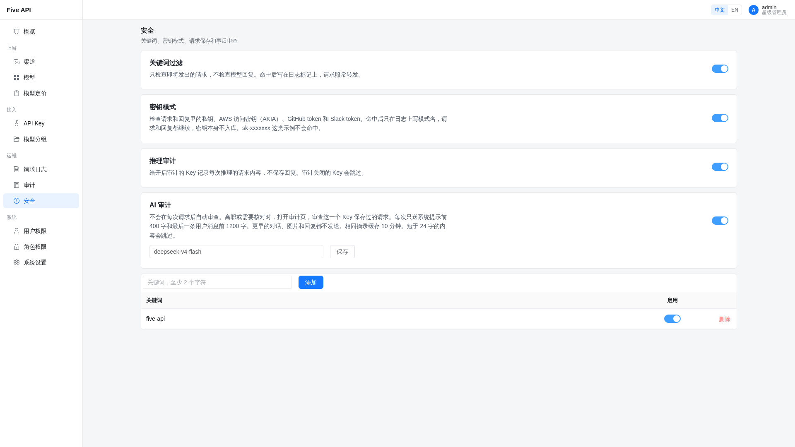
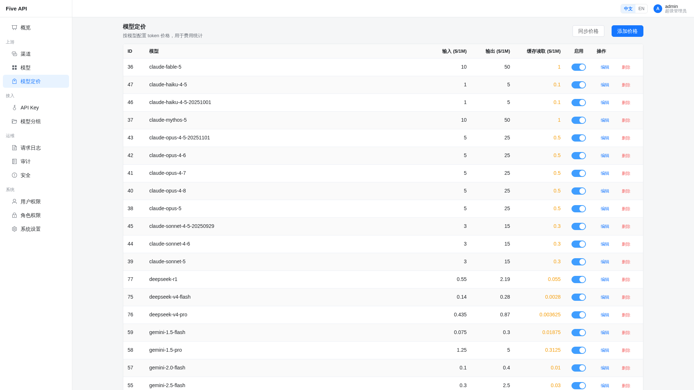

# Five API

[English](README.en.md) · [更新记录](CHANGELOG.md)

[](https://github.com/timmy1688/five-api/actions/workflows/ci.yml)

自托管的团队 AI 网关。上游 Key 留在网关里。每个人拿自己的 Key，带独立的美元配额、可用模型和限流。Claude Code 和 OpenAI SDK 只改地址。

## 优势

**Claude Code 直接能用，工具和 thinking 都在。** `/v1/messages` 原样进 Anthropic 渠道，`tool_use`、`thinking`、流式和厂商 Beta 都保留。OpenAI 请求同样原样进 OpenAI 兼容渠道。同一个模型可以建两条渠道，各接各的客户端。

```bash
export ANTHROPIC_BASE_URL=http://your-server
export ANTHROPIC_API_KEY=sk-your-gateway-key
```

**每个人花了多少钱，能和厂商账单对上。** 额度按美元记在 Key 上。一次请求四档：输入、缓存读取、缓存写入、输出。Claude 的缓存写入按输入价的 1.25 倍计，其他模型与输入价相同。请求开始时按估计金额预留额度，结束后按实际用量结算。Key 可以限制每分钟请求数和每分钟 token 数。

**安全检查不打断调用。要查一个人，再按 Key 审。** 关键词只看即将发出的请求。密钥模式检查请求和回复里的私钥、AWS 访问密钥、GitHub token 和 Slack token，日志只写模式名，密钥原文不入库。命中之后请求和回复都继续。配额、模型权限和限流才会拒绝。

推理审计只给打开审计的 Key 保存请求，不保存回复。AI 审查不跟在每次请求后面。打开审计页，这个 Key 保存过的请求逐条审查，每条只送系统提示开头 400 字和最后一条用户消息末尾 1200 字。更早的对话、图片和回复都不送，所以请求再多，单次上下文的长度也不变。相同摘录 10 分钟内不重复送。审完可以生成报告并下载。脚本类 Key 可以关掉审计，这个 Key 就不标记、不审查、也不存请求正文。安全页建议打开密钥模式，关键词只加内部代号，AI 审计填一个便宜的 OpenAI 兼容模型。

| | Five API | 常见网关 |
|---|---|---|
| Claude Code | 请求原样到达上游，工具和 thinking 还在 | 转成另一种格式后再转发 |
| 计费 | 按人记账，缓存写入按厂商规则单独计价，额度先预留再结算 | 只记总量，并发时会超额 |
| 安全 | 命中只记日志。按 Key 逐条审，每条只送一小段摘录 | 命中就中断这次请求 |
| 故障 | 同协议渠道切换，连续失败后熔断 | 常常跨协议找下一家 |
| 代码 | 约 1.4 万行，Python + Vue 3，19 项权限 | 往往数万行 |

## 界面

管理后台和 API 在同一个进程里。















## 生产部署

安装 Docker 后，在项目目录执行：

```bash
docker compose up -d
```

不需要复制 `.env`。有发布镜像时直接拉取 `ghcr.io/timmy1688/five-api`，拉不到就用本地源码构建。管理后台和 API 在同一个端口，默认是宿主机的 80，浏览器打开 `http://服务器地址`。首次登录 `admin` / `admin123`，系统会先要求改密码，改完才能进后台。数据库、Redis 和签名密钥都在 `./data`，`docker compose down` 不会删掉这个目录。

网关等 MySQL 和 Redis 就绪后才执行迁移。`/healthz` 返回两者的状态，Docker 健康检查用的就是它。`/metrics` 默认只允许容器内访问；Prometheus 要从外面抓，在 `docker-compose.yml` 填 `METRICS_TOKEN`，抓取时带 `Authorization: Bearer <令牌>`。

要改对外端口或密码，直接改 `docker-compose.yml` 里的对应值，然后重新执行 `docker compose up -d`。管理员账号已经创建之后，再改 `INIT_ADMIN_PASSWORD` 不会更新已有密码。

```bash
docker compose up -d --build   # 改了源码后重新构建
docker compose logs -f gateway
docker compose down
```

升级到新版本后，在「模型定价」点一次「同步最新价格」。每个版本的变化见 [CHANGELOG.md](CHANGELOG.md)。

## 开发

本机需要 Python 3.11+、Node.js 20+ 和 Docker。数据库仍由 Compose 启动，账号用上面的默认值，也不需要 `.env`。

```bash
./service.sh install
./service.sh start
```

前端在 `http://localhost:5001`，后端在 `http://localhost:5002`。页面上的 `/api` 和 `/v1` 会转到后端。

```bash
./service.sh stop
./service.sh logs
```

数据库账号和 `docker-compose.yml` 里写的是同一套。要改密码，两边写成一样：Compose 改那个文件，本机后端再放一份 `.env`。

## 接入

渠道的 `provider` 是线协议。`openai` 接 OpenAI、Gemini、千问、vLLM 和兼容中转；`anthropic` 接 Claude 或 DeepSeek 的 Anthropic 端点（`https://api.deepseek.com/anthropic`）。

创建 Key 后复制 `sk-xxx`（只显示一次）。模型定价页同步一次内置价格。渠道上某档价格设成 0，这一档就免费。

请求里没写的字段不会补上，上游用自己的默认值。上游的限流响应头（`x-ratelimit-*`、`anthropic-ratelimit-*`、`retry-after`、`request-id`）原样交回，SDK 的退避逻辑照常工作。上游的 `x-request-id` 改名为 `x-upstream-request-id`，网关自己的 `X-Request-ID` 用来查日志。Claude Code 调的 `/v1/messages/count_tokens` 转发到 Anthropic 渠道，不计费，上游没有这个接口时返回本地估算。

```python
from openai import OpenAI
client = OpenAI(api_key="sk-your-gateway-key", base_url="http://your-server/v1")
client.chat.completions.create(model="gpt-4o", messages=[{"role": "user", "content": "Hello"}])
```

```
fresh = prompt - cache_read - cache_write
cost  = (fresh × 输入价 + cache_read × 缓存读价 + cache_write × 缓存写入价 + completion × 输出价) / 1_000_000
```

先用渠道价，再用全局价。渠道没填写入价时按该渠道的输入价计，填 0 则写入免费。配额先预留再结算。已有的全局价格要在定价页点一次「同步最新价格」，Claude 的写入价才会变成输入价的 1.25 倍。

## 其他

```bash
cd backend && ../.venv/bin/pytest -m smoke && ../.venv/bin/pytest -m regression
```

可选的环境变量见 [.env.example](.env.example)。架构见 [CLAUDE.md](CLAUDE.md)。[MIT License](LICENSE)。费用是估算，可能和上游账单不一致，说明见 [法律风险与免责声明](DISCLAIMER.md)。
