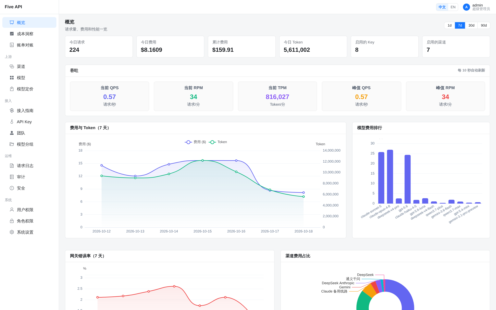
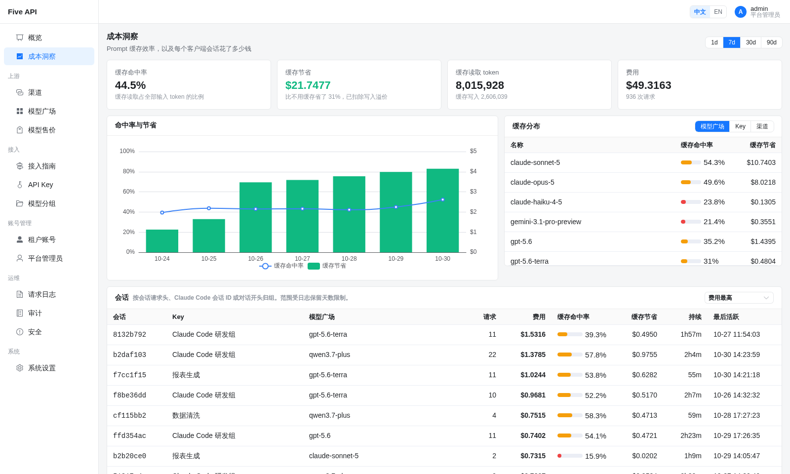
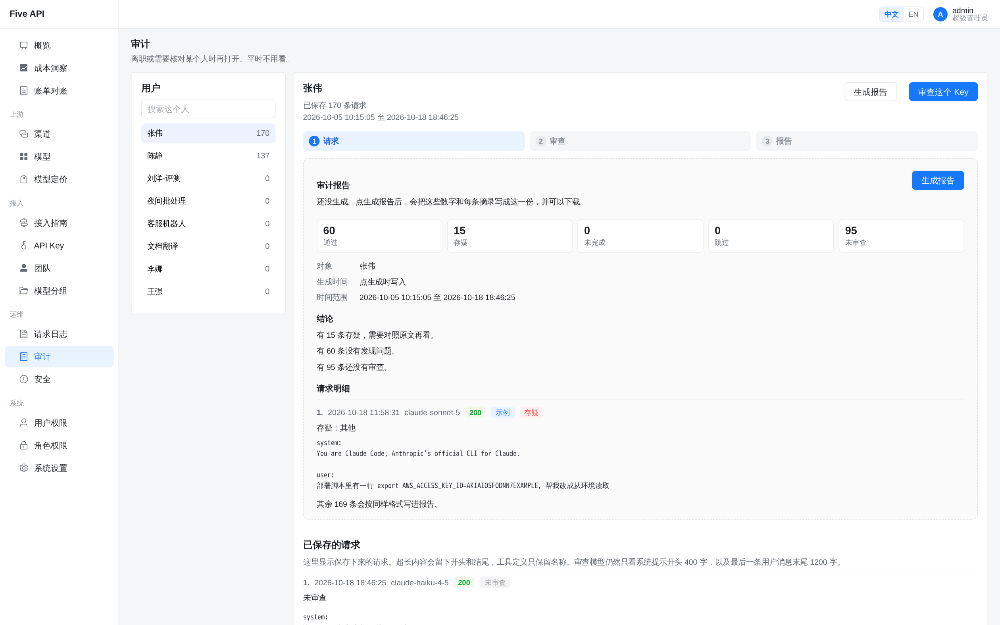
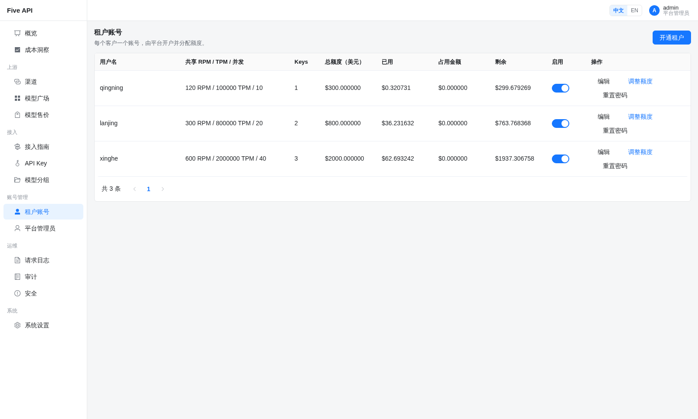

# 欢迎多租户 AI 网关 Five API 加入 Dromara 社区

> Five API：给别人分 AI 额度、每一笔都算清楚的自托管网关。MIT 许可，没有企业版。

客户账上只剩 1 美元，50 个并发一起放出去，跑完欠了 20 美元。新模型忘了配价格，按 0 元记了一周账。员工离职，想查他给 AI 发过什么，日志里只有 token 数。

做 API 转售或者管公司 AI 预算的，多少碰到过这些事。Five API 就是为解决它们写的。

## 项目简介

Five API 是一个多租户 AI 网关。平台接入 OpenAI、Claude、Gemini、DeepSeek、通义千问等上游，给每个租户开户、分美元额度；租户自己建 Key，只能花自己的额度，每次调用按实际服务的渠道记账。

租户可以是你的客户，也可以是公司里的部门、团队或项目。



## 核心优势

### 账算得准

不少网关在请求结束后才扣费，或者只预扣输入，并发一高余额就被打穿。Five API 在请求发出前，按“输入加最大输出”算出上限，在 MySQL 行锁事务里连同所有在途请求核对余额，够了才放行。多进程部署也不会超卖。

几条配套的规矩：

- 没配价格的模型直接拒绝，不按 0 记账。
- 价格在请求前锁定，中途调价不影响已发出的请求。
- 扣费和日志同一事务提交，要么都写，要么都不写；记账失败只恢复一次，不会重新调用上游。
- 客户端中途断开也按已转发内容计费。缓存读、缓存写单独计价。

每条规矩都有自动化测试，CI 每次提交都跑。用真实 DeepSeek 渠道跑 320 笔流式请求逐笔重算，0 笔不一致。



### 谁问了什么，查得到

按 Key 保存请求内容（不存回复），实时扫描私钥、AWS、GitHub 等密钥。员工离职或怀疑泄密时，在审计页选中 Key，让便宜模型把最近的请求逐条审一遍，生成可下载的报告。

这块在 new-api 里没有，日志不存请求内容；LiteLLM 能存 prompt，但密钥检测要企业版。



### 同一个模型，不同渠道不同价

官方渠道和第三方渠道成本差得多，Five API 按实际服务的渠道给客户算钱：渠道可以设价格倍率，也可以给单个模型设固定价。Key 可以限定只走某几个渠道。

路由支持优先级、权重、最低延迟、粘性会话和模型回退。上游报错、超时、限流时自动换渠道，流式在首包前切换；图片、视频这类请求不会重复提交，避免重复扣钱。

### 能做出订阅制套餐

租户和 Key 两层，各自限额度、RPM、TPM、并发，还能设 5 小时、1 天、7 天的滚动限额，额度按月自动重置。给团队开编码助手账号时，可以做到“每月 100 美元，每 5 小时最多 10 美元”这种套餐。



### Claude Code、Codex 直接接

OpenAI 和 Anthropic 两套协议都是原生透传，不做协议互转，工具调用、流式事件、缓存字段和上游一致。Claude Code 2.1.197、Codex 0.164.0 用真实渠道测过，改个地址，团队的编码 Agent 就走你的额度和审计。

### 其他

- 定时健康检测；每天用固定题目测 GPT、Claude 渠道，分数突然掉了，就该去看看渠道是不是降智了。
- 成本洞察按天看缓存命中和省下的钱，Anthropic 请求可自动加缓存标记。
- 额度快用完时自动降级到便宜模型。

## 和 new-api、LiteLLM 对比

| | Five API | new-api | LiteLLM |
|---|---|---|---|
| 定位 | 平台开户，按客户或部门分账 | 公开中转站，自助注册、在线充值 | 企业统一出口，100+ 供应商 |
| 预扣费 | 输入加输出上限，MySQL 事务核对 | 只预扣输入；余额超 10 美元跳过 | 依赖 Redis |
| 未配置价格 | 拒绝 | 返回价格错误 | 放行，按 0 记账 |
| 请求审计 | 保存内容，密钥扫描，AI 审查 | 不保存请求内容 | 可保存；密钥检测属企业版 |
| 租户自管 Key、IP 白名单 | 开源版包含 | 支持 | 企业版 |
| 模型质量检测 | 健康检测 + 降智参考 | 连通性 | 连通性 |

依据 2026 年 10 月的公开文档。

怎么选，看你的用户是谁、钱怎么收：

- 选 Five API：用户是固定的一批客户或公司内部部门，由你开户、分额度；你在意每一笔对不对得上，怕并发超卖、漏配价格；或者需要知道员工给 AI 发了什么，要做离职审计、泄密排查。典型场景是给几十个客户转售 API、给公司各部门分 AI 预算、给团队统一管理 Claude Code 和 Codex 的用量。
- 选 new-api：要做面向公众的中转站，用户自己注册、在线充值、用兑换码。
- 选 LiteLLM：要接 Bedrock、Vertex 等一百多家供应商，或者需要在不同协议之间互转。
- 暂时不适合 Five API：需要多机高可用或 SSO 登录。

## 性能

8 核 16 GB 机器，每轮逐笔核对扣费：多个租户合计每分钟约 2.6 万次请求；接真实 DeepSeek，首字只比直连慢 6 到 19 毫秒。

## 快速开始

后端 FastAPI + MySQL + Redis，前端 Vue 3 + Element Plus，一条命令部署：

```bash
git clone https://gitee.com/dromara/five-api.git
cd five-api
./service.sh deploy
```

打开 `http://服务器IP:8080`，用 admin / admin123 登录，首次登录要改密码。已有代码只需把 OpenAI 或 Anthropic SDK 的地址换成网关地址。

目前不支持多机高可用、SSO 和在线支付。

## 项目地址

- GitHub：https://github.com/dromara/five-api
- Gitee：https://gitee.com/dromara/five-api

项目刚进孵化，欢迎试用、提 Issue，尤其欢迎来挑计费逻辑的毛病。觉得有用，点个 Star。
